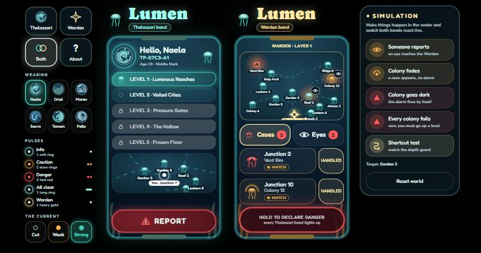
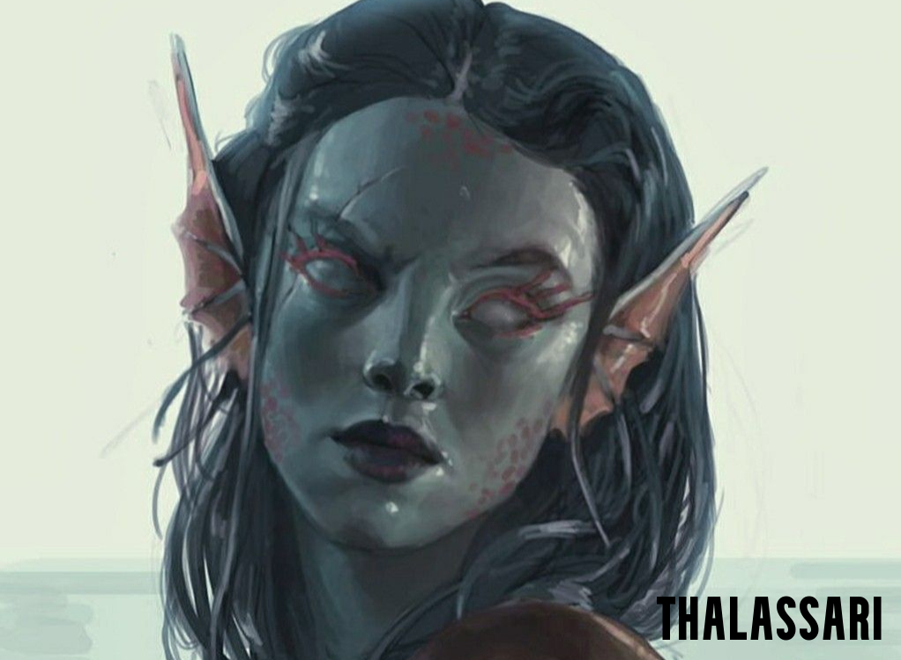
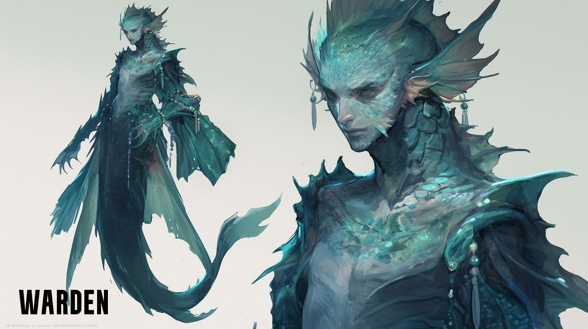
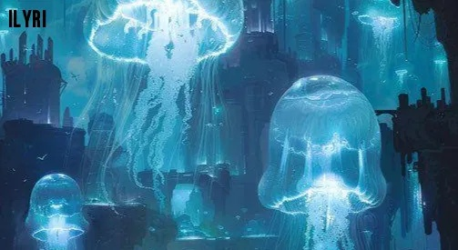
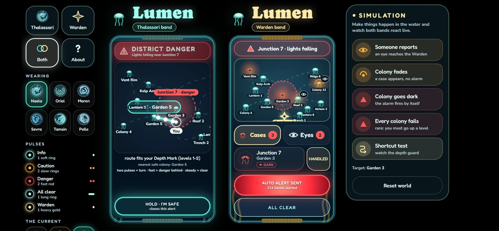
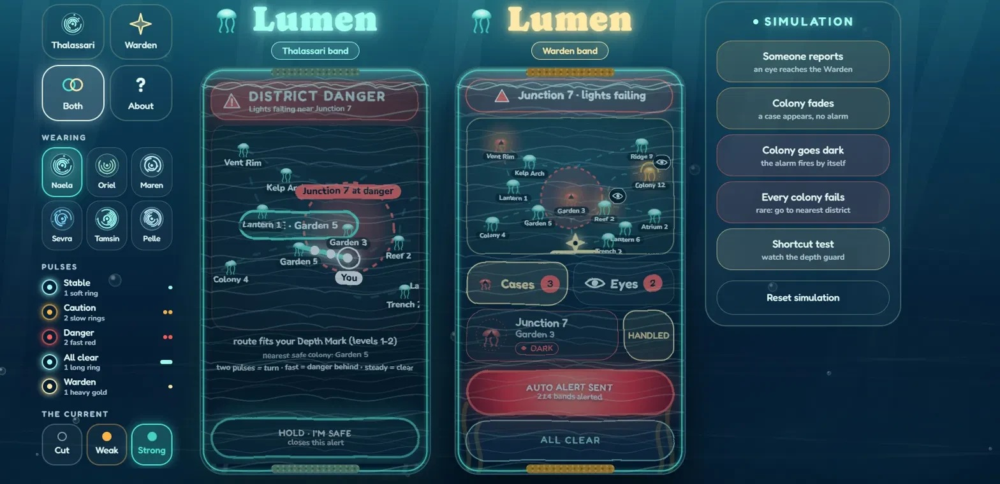

<div align="center">


<h3></h3>


**[Try it live: lumen-xi-nine.vercel.app](https://lumen-xi-nine.vercel.app)**

</div>

<hr />

<div align="center">

</div>

<h2></h2>

THALASSA (inspired by the Greek Goddess of the sea) is an ocean-only universe. There is no land or sky. Life is organised by water depth,
pressure, darkness, temperature, and moving Currents.

In THALASSA, every person is born as one of four species: Thalassari, Vael, Veyr, or Orun. Thalassari are ordinary citizens who mostly live in the first two layers, and at age 12, they undergo the Depth Rite, which determines how deep they can safely travel or work. They collect Nerea, a rare mineral used as currency, while glowing jellyfish-like creatures called Ilyri provide essential light, navigation, and warnings throughout the world. Wardens (Orun) protect Ilyri colonies, but some Thalassari secretly steal Ilyri and trade them with deep-dwelling Veyr in exchange for rare minerals. Since Veyr cannot survive the lower pressure of the upper layers, they depend on these illegal trades, which damage Ilyri colonies and threaten entire communities.

The digital product is called **LUMEN** is a living wrist-band system that helps wardens protect glowing Ilyri
colonies, the source of public light, navigation, and danger warnings. When Ilyri are stolen, areas become dark and
unsafe. LUMEN allows citizens to report the problem and lets Wardens respond before a district loses its light.

This is not "a normal app with an underwater skin." It could only exist in this universe because it uses water
pressure, bioluminescent signals, depth permissions, Currents, and living Ilyri colonies.

<h3></h3>

```bash
git clone https://github.com/vaishhhh01/vinhackuiux.git
cd vinhackuiux
npm install
npm run dev      # http://localhost:5173
```

```bash
npm test         # unit tests: escalation, routing, where-to-go, patrol, alert machine
npm run build    # type-check + production build + service worker (Vercel-ready)
```

<h3></h3>

| Layer | Name | About |
|---|---|---|
| 1 | Luminous Reaches | contains farms, markets, families and coral forests |
| 2 | Veiled Cities | middle-depth cities |
| 3 | Pressure Gates | Dangerous checkpoints and current gates |
| 4 | The Hollow | Restricted, dark trenches |
| 5 | Frozen Floor | Near-unreachable deepest waters for Aethons |

<h3></h3>

| Creature | Role in the world |
|---|---|
| **Thalassari** | Main citizens like farmers, workers |
| **Wardens** | Guardian species |
| **Vael** | Sound-based beings |
| **Veyr** | Deep-water predator-like beings who feed on Ilyris |
| **Orun** | Giant whale-like memory keepers |
| **Ilyri** | Glowing jellyfish-like creatures that provide light |
| **Aethons** | Ancient, enormous beings under the deepest waters |

<div align="center">

<br /><br />

</div>


<h3></h3>

**Nerea.** crystal pearl currency of THALASSA used for everyday purchases, food, tools and transport,
and for exchanging goods between travellers and Thalassari.

**Ilyri** are considered the essential element to survival in THALASSA (equivalent to oxygen on earth). Thalasarri's survival in colonies
without Ilyri's light isnt possible underwater. Thus, they serve an important factor to the universe.

**Depth Rite Ritual** At 12, every Thalassari is measured in a controlled Pressure Well: safe pressure, sight in darkness,
glow strength (their **Tideprint**), tolerance to cold, warm water and fast Currents, and Current-sensing. They leave
with a permanent glowing **Depth Mark**, their personal LUMEN Band, and travel permissions for the deepest layer
their body can safely enter.

**Wardens.** are powerful but limited to only one depth layer each, they are able to sense disturbances and run protection systems
there, unable to patrol freely, and rare, so each covers many colonies, districts and Current routes.

**Ilyri harvesting is illegal** Wild (protected, free-drifting), legally harvested (licensed nurseries and permitted
zones), and illegal. removing Ilyri from one without permission, transporting them without authorisation, or damaging the habitat triggers a Warden
investigation.

**Currents** are THALASSA’s supply routes. They carry food, warm water, minerals and trade goods from the productive Luminous Reaches down to the deeper layers, which can’t grow their own.

<h3></h3>

1. Wardens in THALASSA investigate and keep records of thefts, but each Warden guards a whole layer and cannot watch every district. When colonies die, districts lose light, travel becomes dangerous, and citizens cannot report threats fast enough. 
2. Citizens and Wardens need a shared system to monitor Ilyri health, report what they witness, and respond before a district goes dark.

<h3></h3>

LUMEN is a wristband network which works on pressure, water pulses and bioluminescent light, that gives Wardens eyes in every district. It detects unusual activity around protected colonies, allows citizens to silently report suspected illegal harvesting, and alerts Wardens so they can investigate before the damage spreads. When a genuine threat is confirmed, LUMEN warns nearby citizens and guides them through safe routes within their Depth Mark. It also helps Wardens track reports, monitor colony safety, and coordinate patrols across different layers. By connecting citizens, Wardens, and the Current communication network, LUMEN helps prevent illegal Ilyri trading while protecting both the ecosystem and the people who depend on it.

<h3></h3>

**Naela** : Age - 19, Middle Mark Thalassari. Lives and works in Layer 2 and visits her family in Layer 1.

- **Needs:** to know she's safe, which way to swim, and a way to report what she sees without stopping.
- **Frustration:** she sees theft but can't communicate with Warden on time.
- **Context:** one-handed, mid-swim, possibly scared.

**The Layer 1 Warden.** A rare, layer-bound guardian responsible for hundreds of colonies.  
- **Needs:** They need report of each colony's Ilyri's condition in one place. Trustworthy information and not noise
- **Frustration:** Cant manage all colonies in the district at once and provide a way for Thalassari's to safety quickly.

<h3></h3>

1. Naela passes a Colony in Level 1 and sees theft happening (Ilyri's being stolen from the colony)
2. She presses and holds the band, and the theft report goes out with her layer and location attached.
3. She optionally says which colony she thinks they're heading to.
4. On the Warden's band, the report appears under **Eyes** for that colony.
5. The Warden opens the eye, sees who reported and where the thief is heading, and holds **DANGER**.
6. Every band in the affected area pulses red. Naela's band shows a glowing route to the nearest safe colony,
   within her depth.
7. The Warden follows the patrol route, stops the thieves and marks the case handled.
8. If the Warden cant help the colonies on time, Danger alert given to alert the Thalasarri's in the colony on time for safety exit.
<h3></h3>

- **The interface is made of the world itself:** pressure, water pulses, bioluminescent light, coral. No
  glass or notification buttons and small fonts.
- **Panic-proof:** the alert overrides everything and can't be dismissed accidentally, and **REPORT** is always
  one press from Home.
- **One-thumb reach:** everything works on your own wrist, one hand, mid-swim.
- **It encodes the social structure:** citizens get simplicity and one duty (report what you see); Wardens get
  breadth and authority (cases, patrols, broadcasts).
- **Zero typing, zero memory:** the band knows your layer, your district, your colony. Humans supply only what they
  saw.
- **The sensors+witnesses model mirrors real ecology:** instruments detect anomalies, people provide truth.
  That is why both bands exist, and why neither is redundant.
- **Visual storytelling:** You can read the state of a district at a glance, the way a glowing underwater thalassari's would build it.
  (Example: health is colour, urgency is pressure on the wrist, safety is a glowing line of living
  light.)

<div align="center">

</div>

<h2></h2>

<h3></h3>

**Left side**
   - contains Thalassari/ Warden/ Both views, Wearing (profiles of Thalasarri), About pulses and simulate current.

**Right side, SIMULATION:**
   - containing information about what happens when someone reports, when colony fades, when colony goes dark,
when all colonies fail and shortcut test and to reset simulation.

**Real time:** both bands read one store, and separate browser windows are linked through a `BroadcastChannel`,
   so a Thalassari report in one window shows up in a Warden window.

<div align="center">

<br /><sub>A sensor-triggered alert: the affected Thalassari follows the route to the nearest safe colony while the Warden sees the same danger.</sub>
</div>

<h3></h3>

An optional **Water view** toggle sits in the bottom-left corner of the site(off by default)
It is there to check how readable and accessible the bands stay under water.

<div align="center">

</div>

<h2></h2>

React 18 + TypeScript + Vite, Tailwind, Framer Motion, Zustand, XState v5,
Dexie (IndexedDB offline queue), d3-scale / d3-shape, Workbox PWA (vite-plugin-pwa), Vitest. 
Vercel for deployment

<h3></h3>

- Pinterest for the art concepts
- Google Fonts for fonts
