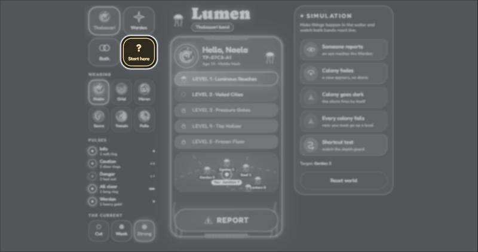

<div align="center">


### The app for solving Thalassa's problem


</div>

<hr />

<div align="center">

</div>

## About

THALASSA is an ocean-only universe. There is no land, sky, or human technology. Life is organised by water depth,
pressure, darkness, temperature, and moving Currents.

The digital product is called **LUMEN**: a living wrist-band system that helps citizens protect glowing Ilyri
colonies, the source of public light, navigation, and danger warnings. When Ilyri are stolen, areas become dark and
unsafe. LUMEN allows citizens to report the problem and lets Wardens respond before a district loses its light.

This is not "a normal app with an underwater skin." It could only exist in this universe because it uses water
pressure, bioluminescent signals, depth permissions, Currents, and living Ilyri colonies.

### Setup

```bash
git clone https://github.com/vaishhhh01/vinhack-uiux.git
cd vinhack-uiux
npm install
npm run dev      # http://localhost:5173
```

```bash
npm test         # unit tests: escalation, routing, where-to-go, patrol, alert machine
npm run build    # type-check + production build + service worker (Vercel-ready)
```

The first screen after it opens: everything is veiled in gray and only **About** pulses. Open it, read it, close it,
and the whole site unlocks.

<div align="center">

</div>

### Layers of Thalassa

| Layer | Name | Character |
|---|---|---|
| 1 | Luminous Reaches | Warm, bright waters with schools, farms, markets, families, and coral forests |
| 2 | Veiled Cities | Stable middle-depth cities with government, engineering, archives, and major trade |
| 3 | Pressure Gates | Dangerous checkpoints and engineering zones where Currents are maintained |
| 4 | The Hollow | Restricted, dark trenches; specialised outposts, research, and Veyr territories |
| 5 | Frozen Floor | Near-unreachable deepest waters with ruins, ancient creatures, and Aethons |

### Creatures of Thalassa

| Creature | Role in the world |
|---|---|
| **Thalassari** | Main citizens: families, students, workers, traders, reporters, and travellers |
| **Wardens** | A rare separate guardian species, each biologically connected to one layer |
| **Vael** | Sound-based beings who relay messages and sense danger |
| **Veyr** | Deep-water predator-like beings; some participate in the illegal Ilyri trade, but not all |
| **Orun** | Giant whale-like memory keepers whose songs contain old knowledge |
| **Ilyri** | Glowing jellyfish-like creatures that provide light and warnings |
| **Aethons** | Ancient, enormous beings that inhabit the deepest unknown waters |

<div align="center">

<br /><br />

</div>

### Rules of Thalassa

**Nerea.** A small, durable, light-reactive crystal pearl used for everyday purchases, food, tools and transport,
and for exchanging goods between travellers and Thalassari. It is a mineral currency, never made from Ilyri, so the
economy does not depend on extracting the very organisms the civilisation protects.

**Depth Rite.** At 12, every Thalassari is measured in a controlled Pressure Well: safe pressure, sight in darkness,
glow strength (their **Tideprint**), tolerance to cold, warm water and fast Currents, and Current-sensing. They leave
with a permanent glowing **Depth Mark**, their personal LUMEN Band, and travel permissions for the deepest layer
their body can safely enter.

**Wardens.** Powerful but limited: one depth layer each, able to sense disturbances and run protection systems
there, unable to patrol freely, and rare, so each covers many colonies, districts and Current routes.

**Ilyri harvesting** Wild (protected, free-drifting), legally harvested (licensed nurseries and permitted
zones), and illegal (taken from registered colonies). Registered colonies are never a legal source: removing Ilyri
from one without permission, transporting them without authorisation, or damaging the habitat triggers a Warden
investigation.

**Currents** are THALASSA’s supply routes. They carry food, warm water, minerals and trade goods from the productive Luminous Reaches down to the deeper layers, which can’t grow their own. Each Current has a safe stretch and a dangerous one, so cargo crews and travellers ride only the lit stretches that Ilyri colonies mark. In Lumen a dying colony or a declared danger can mark that stretch of Current as unsafe, which reroutes citizens on the Safe Route screen and also tells the Warden which supply routes are at risk.

### Problem statement

In THALASSA, Ilyri colonies provide light, safe navigation, and warnings for every layer. But an illegal trade is
draining them: some Thalassari, who have legal access to Ilyri habitats, steal colonies to sell to buyers in the
deep, including some Veyr who need Ilyri to survive. Wardens investigate and keep records of thefts, but each Warden
guards a whole layer and cannot watch every district. When colonies die, districts lose light, travel becomes
dangerous, and citizens cannot report threats fast enough. Citizens and Wardens need a shared system to monitor Ilyri
health, report what they witness, and respond before a district goes dark.

### Proposed solution

Citizens and Wardens need a shared system to monitor Ilyri health, report suspicious activity, and respond before a
district goes dark.

LUMEN is a wristband network that gives Wardens eyes in every district. Colony sensors flag unusual decline,
citizens confirm what they saw with one press, and the Warden judges the evidence, declares danger and guides
everyone to safety. **LUMEN never accuses anyone. It gathers evidence so the Warden can.**

Wardens have colony data, but data says *what* is happening, not *who* is doing it, and slow declines look like
natural fluctuation. Citizens have eyes but no fast channel. LUMEN joins the two:

- Sensors flag anomalies quietly.
- Citizens confirm with one press.
- The confirmed case escalates to the Warden.
- The Warden declares danger.
- Citizens get safe routes before the district goes dark.

### Personas

**Naela**, age 19, Middle Mark Thalassari. She lives and works in Layer 2 and visits her family in Layer 1. She
can't enter Layers 3 to 5.

- **Needs:** to know she's safe, which way to swim, and a way to report what she sees without stopping.
- **Frustration:** she sees theft but can't reach a Warden in time.
- **Context:** one-handed, mid-swim, murky water, possibly scared.

**The Layer 1 Warden.** A rare, layer-bound guardian responsible for hundreds of colonies. They can't be
everywhere. They need prioritised, trustworthy information, not noise.

### Primary user flow

1. Naela passes a Current junction and sees two figures loading glowing creatures into a pressure crate.
2. She presses and holds the band, and the theft report goes out with her layer and location attached.
3. She optionally says which colony she thinks they're heading to.
4. On the Warden's band, the report appears under **Eyes** for that colony.
5. The Warden opens the eye, sees who reported and where the thief is heading, and holds **DANGER**.
6. Every band in the affected area pulses red. Naela's band shows a glowing route to the nearest safe colony,
   within her depth.
7. The Warden follows the patrol route, stops the thieves and marks the case handled.
8. The bands settle: all clear.

### Why the design belongs to Thalassa

- **The interface is made of the world itself:** pressure, water pulses, bioluminescent light, coral. There is no
  glass, no text-heavy feed, no notification banners, because none of that exists underwater in this culture.
- **It encodes the biology:** depth restrictions are baked into routing and permissions; the Depth Mark is a
  first-class element on the citizen band.
- **It encodes the social structure:** citizens get simplicity and one duty (report what you see); Wardens get
  breadth and authority (cases, patrols, broadcasts), because Thalassari are a distributed population and Wardens
  are rare, layer-bound specialists.
- **The sensors-plus-witnesses model mirrors real ecology:** instruments detect anomalies, people provide truth.
  That is why both bands exist, and why neither is redundant.
- **Visual storytelling:** health is colour, urgency is pressure on the wrist, safety is a glowing line of living
  light. You can read the state of a district at a glance, the way a glowing underwater people would build it.

<div align="center">

</div>

## About LUMEN

### Accessibility and usability

What Thalassari would actually demand:

- **Glanceability:** every screen readable in under a second while swimming. One idea per screen.
- **Large targets, webbed hands:** minimum 64 px touch targets, a few fat buttons instead of many small ones.
- **Redundant encoding:** never colour alone. A fading colony is amber with a slow pulse and a half-ring; danger is
  red with a fast double pulse and a solid triangle. Murky water and dim light make colour unreliable; vibration
  patterns are not.
- **One-thumb reach:** everything works on your own wrist, one hand, mid-swim.
- **Panic-proof:** the alert overrides everything and can't be dismissed accidentally, and **REPORT** is always
  one press from Home.
- **Zero typing, zero memory:** the band knows your layer, your district, your colony. Humans supply only what they
  saw.
- **Calibrated trust:** citizens see "danger" or "safe" and a route, never "theft confirmed by suspect X". No mobs,
  no false accusations; Wardens stay the only accusers. Citizens are not even shown colony health.
- **Press-and-hold on every critical action** (report, declare danger): "pressure = intent", straight from the lore,
  and it prevents accidental triggers.

### Using the site

1. **On every load or refresh** the page is veiled in gray and only the About button pulses. Open About, read it,
   close it; then everything is usable.
2. **Left side**
   - **Thalassari / Warden / Both:** choose a band, or see both side by side.
   - **Wearing:** six Thalassari, each with their own Tideprint, Tideprint ID, Depth Mark and place on the map.
     Naela and Oriel stand at the same colony (Garden 3); everyone else is somewhere different.
   - **Pulses:** key to the alert flashes.
   - **The Current:** Cut / Weak / Strong signal.
3. **Right side, SIMULATION:** makes things happen in the world.
   - *Someone reports:* a Thalassari reports from their own colony.
   - *Colony fades:* a case appears, no alarm.
   - *Colony goes dark:* the alarm fires by itself (sensor-triggered).
   - *Every colony fails:* the rare case, everyone must go up a level.
   - *Shortcut test:* shows the depth guard stopping a route that is too deep.
   - *Reset world:* back to the start (with the two default reports).
4. **Real time:** both bands read one store, and separate browser windows are linked through a `BroadcastChannel`,
   so a Thalassari report in one window shows up in a Warden window.

The world starts with **two user reports already waiting** (Maren at Reef 2, Tamsin at Colony 12).

### The bands

**Thalassari** (no swiping, every step is a big button)
- Home: Tideprint and ID, Depth Mark, five-level ladder, a small map (a view only), **REPORT**.
- **REPORT** goes straight to the colony you are standing at. A wearer can only report where they are. Hold
  **REPORT THEFT** (1 s). An optional "where are they going?" card follows and fades on its own.
- Only the people in the affected area get the **danger** takeover: a red alert, two red edge flashes, then a map
  that grows and frames them and their way out. Everyone else keeps their normal Home.
- The route goes to the **nearest bright colony** outside the red zone, never deeper than the wearer's Depth Mark.
  Only if every colony has failed does it send them up a level (a Shallow mark gets "stay still").

**Warden**
- The district map, then two buttons, **Cases** and **Eyes**, that switch the list shown right below them.
  **Cases** are what the sensors flagged; **Eyes** are what Thalassari reported (Tideprint ID, where, where the
  thief was heading, or `nil`).
- **HANDLED** sits on the side of every row; press the middle of a row for its popup.
- An eye's popup has **PATROL** and a hold-to-declare **DANGER**. One eye is enough, and a red colony can be
  declared directly. **ALL CLEAR** sends everyone home.

### The Current

The Current is the water network data travels on. The thin edge of each band shows it: steady (strong), flickering
(weak), gray dashes (cut). While cut, reports and declarations are saved in IndexedDB and sent when it returns.

## Tech Stack

React 18 + TypeScript + Vite, Tailwind (tokens in `src/styles/tokens.css`), Framer Motion, Zustand, XState v5,
Dexie (IndexedDB offline queue), Workbox PWA, Vitest. Vercel for deployment

| Rule | File |
| --- | --- |
| WATCH < 70 %, rapid decline > 15 pts / 24 h, CRITICAL < 20 %, 1 eye for danger | `src/logic/thresholds.ts`, `src/logic/escalation.ts` |
| Router never emits a layer deeper than the Depth Mark | `src/logic/routing.ts` (`safeRoute`) |
| Nearest safe colony, next level as a last resort, who must move, local reporting | `src/logic/district.ts` |
| calm → flagged → escalated → danger → allClear | `src/state/alertMachine.ts` |
| Offline queue | `src/state/queue.ts` (Dexie), flushed in `src/state/store.ts` |
| Cross-window live sync | `src/state/sync.ts` |
| Press-and-hold (1000 ms, pressure-aware, keyboard) | `src/components/PressureButton.tsx` |
| Pulse patterns + Vibration API | `src/components/PulseHaptics.ts`, `src/components/AlertPulse.tsx` |

### Credits

- Pinterest for the art concepts
- Google Fonts for fonts

### Notes

- Map space is 100 × 66 units, drawn at 328 × 216 px on the Warden band.
- The "Current silent · N min ago" counter is demo time (1 minute per 6 s, starting at 4).
- The creature artwork in `docs/images` is concept art supplied for this project; check its original credit and
  licence before reusing it outside this repo.
